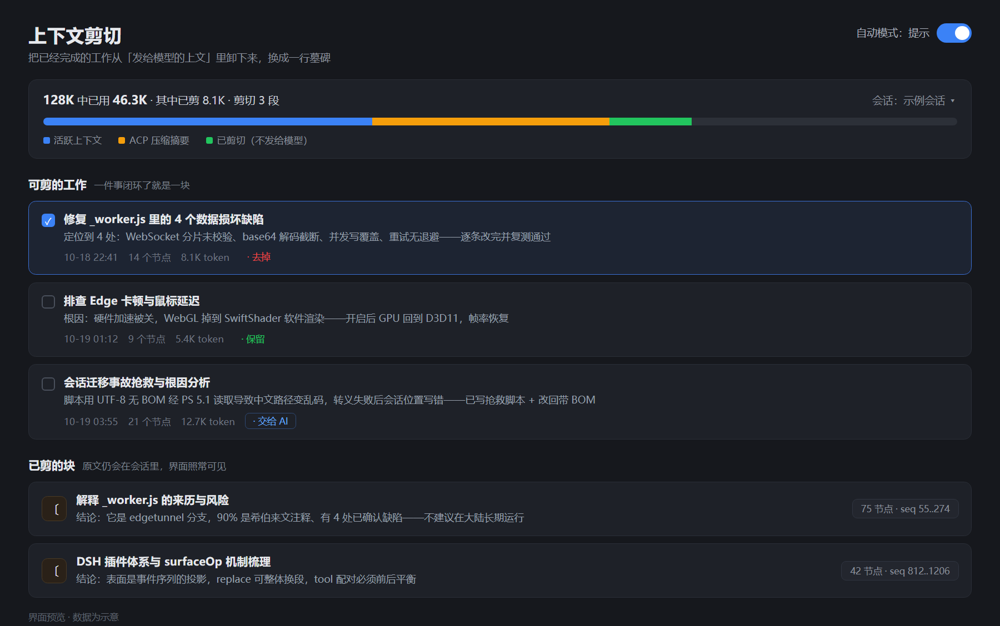

# dsh-context-offload

DSH 插件：把**已完成的工作段**从「上传给模型的上下文」里卸下来，原文仍留在会话中。

## 它解决什么

长会话里，前面做完的事每一轮都要重新发给模型，白花钱。
这个插件让你把那些「已经闭环、后面不会再用原文」的段落剪掉，
上下文立刻变小，但界面上原文还在，随时能取回。

## 用法

设置 → 上下文剪切

1. 「可剪的工作」列出按你每句话切好的段
2. 勾选 → 点 `去掉` / `保留` / `交给 AI`
3. 「执行剪切」
4. 剪过的在「已剪的块」里：**左键看原文**，**右键**命名 / 定位 / 复制 / 导出 / 合并 / 取消剪切

## 自动模式

设置页「自动模式」一栏有三档：`手动` / `提示` / `自动`。

| 档 | 到点之后 |
|---|---|
| 手动 | 什么都不做，只有点按钮才剪 |
| **提示** | 不剪，页面顶部弹横幅「可以剪了：共 N 块，约 XK」+ [现在剪] [忽略] |
| 自动 | 直接剪，剪完留一条 `〔自动剪切 · 剪了 N 段，省 X〕` |

三档共用的规则：

- **触发时机**：用户每发一条消息时检查一次
- **冷却**：距上次 ≥ `cooldownTurns`（默认 10 轮）
- **门槛**：可剪总量 ≥ `minTokens`（默认 20000）
- **保留**：最近 2 轮永远不剪
- **硬约束**：出现「记住 / 别忘 / 答应我 / 承诺 / 约定 / 永远…」等字样的段，**自动模式永不触碰**
- **记账**：写入 `~/.dsh/context-offload-history.json`（最多 50 条），界面上可展开看到剪了哪些块
- **冷却起点**：从「关」切到「开」时，把起点钉在当前轮次，避免一开启就立刻剪一大片

配置文件：`~/.dsh/context-offload-auto.json`

```json
{ "auto": false, "prompt": false, "cooldownTurns": 10,
  "lastOffloadTurn": 0, "lastOffloadAt": 0, "minTokens": 20000,
  "pending": null }
```

> ⚠️ 自动剪切会改会话表面，使**前缀缓存失效**。所以冷却不是可选项——每轮都剪反而更费钱。

## 文件

| 文件 | 作用 |
|---|---|
| `lib/index.js` | 后端：4 个工具 + 9 个 HTTP 路由 + 自动模式 |
| `lib/client.js` | 前端：设置页界面（React，通过 slots 注入）|
| `dsh.bundle.patch.yml` | 挂载声明 |

## 工具（模型可直接调）

| 工具 | 作用 |
|---|---|
| `offload_list` | 列出表面节点 |
| `offload_candidates` | 按用户消息自动切段 |
| `offload_context(start, end, title)` | 剪掉一段 |
| `offload_cancel(tombSeq)` | 取回（墓碑换回原文） |
| `load_context(tombSeq)` | **临时读**原文（只读，墓碑保留） |

## 接口

| 路由 | 作用 |
|---|---|
| `GET  /context-offload/api/state` | 统计 + 候选 + 已剪 |
| `GET  /context-offload/api/sessions` | 会话列表 |
| `POST /context-offload/api/offload` | 执行剪切 |
| `POST /context-offload/api/cancel` | 取消剪切 |
| `POST /context-offload/api/read` | 读原文（`tombSeq` 或 `startSeq`/`endSeq`）|
| `POST /context-offload/api/merge` | 合并相邻两块墓碑 |
| `GET  /context-offload/api/auto` | 读自动模式配置 |
| `POST /context-offload/api/auto` | 改自动模式配置 |
| `POST /context-offload/api/apply-pending` | 按「提示模式」的建议立刻剪 |
| `GET  /context-offload/api/history` | 自动剪切历史 |
| `POST /context-offload/api/ask-ai` | 把「交给 AI」的块写成裁决请求 |

## 「交给 AI」怎么工作

勾选几块 → 点「交给 AI」→ 执行剪切：

- `去掉` 的：直接剪
- `保留` 的：跳过
- **`交给 AI` 的：不剪**，而是往会话里写一条

```
〔待 AI 裁决 · 3 块，共约 37K token〕
  1. Edge 硬件加速修复（12K，seq 100..112）
     gist: 根因是关掉了硬件加速
  ...
  请逐块评估：结论是否已落到别处？后面还会不会用到原文？
  能剪的调 offload_context；不该剪的说清理由。
```

模型下一轮看到这条，逐块判断并调用工具——**用户先筛，AI 后判**。

## 已知限制

- 数字是估算值（中文 0.7/字、其他 1/3.8 字符），不是精确 tokenizer
- 「合并到上一块」不可逆（合并后只能整块取消剪切重剪）
- 其他会话的候选是**只读重建**的，不能在那里剪
- 聊天流里墓碑仍是纯文本，没做成可折叠卡片

## 实现要点（给未来的自己）

- 剪切 = 往表面写一条 `user/message`，带 `surfaceOp: { op:'replace', startSeq, endSeq }`
- 原文一直在 `session.v4.jsonl.zstd` 里，`eventAt(seq)` 随时能读回来
- 墓碑里记 `origin: a..b`，取回时按这个范围**递归展开**（碰到「已取回」副本继续往里钻）
- **千万不要用 min/max 合并 origin** —— 会把范围撑爆，读出一堆无关内容（踩过这个坑）

## 安装

1. 把整个目录放进 DSH 的 profile `node_modules` 里（以默认桌面 profile 为例）：

```bash
cp -r dsh-context-offload ~/.dsh/profiles/desktop/node_modules/
```

2. 在 `~/.dsh/profiles/desktop/package.json` 的 `dsh.profile.bundles` 里登记：

```json
{
  "dsh": {
    "profile": {
      "bundles": ["dsh-context-offload"]
    }
  }
}
```

> 只写进 `bundles`、不写进 `dependencies` 的包，DSH 启动时会被清掉。稳妥做法是两处都写。

3. 重启 DSH，设置里会出现「上下文剪切」。

- 改**后端**（`lib/index.js`）→ 必须重启 DSH
- 改**前端**（`lib/client.js`）→ 刷新页面即可

## 截图



## 许可证

GPL-3.0-or-later。改了就得以同样的许可证开源。
